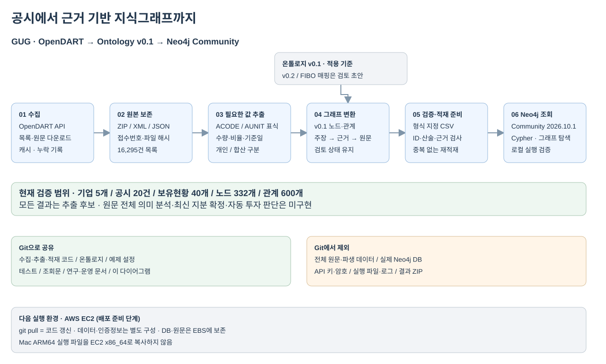

[draw.io 원본 편집](docs/diagrams/overview.drawio) · [로컬 실행](docs/runbooks/local.md) · [EC2 실행](docs/runbooks/ec2.md) · [온톨로지 v0.1](ontology/v0.1/)

# GUG Financial Knowledge Graph

한국 기업의 공시에서 **기업·주주·지분·사건과 원문 근거를 연결하는 지식그래프**를 구축하는 사이드프로젝트입니다. 기업 간 관계를 설명하고, 특정 시점에 어떤 근거를 알 수 있었는지 추적하는 것이 목표입니다. 이후 GraphRAG 질의응답과 시간적 관계 추론으로 확장합니다.

현재는 OpenDART 원문 일부를 **원본 온톨로지 v0.1**에 맞춰 변환하고 Neo4j Community에서 조회하는 파일럿까지 검증했습니다. 전체 원문을 의미 분석한 결과나 현재 지분의 확정 데이터베이스는 아닙니다.

## 현재 상태 한눈에 보기

| 구분 | 진행 결과 | 범위·주의 |
|---|---|---|
| 원천 수집 | 2026-10-01~11-05 공시 목록 16,295건, 기업 3,216개 | 상장·비상장 등 전체 목록이며 분석 대상 기업과 구분 |
| 원문 확보 | 공시 14,035건, XML 파일 14,045개 | 미확보 2,260건은 API의 파일 없음 응답으로 기록 |
| 온톨로지 | 원본 v0.1: 개념 25개·관계 33개 | 현재 파일럿 적용 기준 |
| 확장 초안 | v0.2 통합 XLSX, FIBO 정합성 1차 검토 | 적용 완료·표준 호환 인증을 뜻하지 않음 |
| 추출 파일럿 | 기업 5개·공시 20건·보유현황 40개 | 대량보유 10건 + 임원·주요주주 소유상황 10건 |
| 그래프 | 노드 332개·관계 600개 | 문서·근거·추출 주장 등 관리 객체 포함 |
| Neo4j | Community 2026.10.1, 로컬 적재·조회 검증 | 영속 데이터·인증정보는 Git 밖에서 관리 |
| 비용·효율 | 파일럿 추출용 LLM API 호출 0회 | 코드 실행·검토 대화의 토큰 소비가 0이라는 의미는 아님 |
| AWS | EC2 pull·영속 데이터 분리·Compose 실행 절차 준비 | 실제 EC2 배포 검증은 아직 미실시 |

파일럿 기업: **에이루트, 넥사다이내믹스, 세미파이브, 금호에이치티, 벡트로보틱스**. 목적 표본이며 시장 전체의 대표 표본은 아닙니다.

## 지금까지의 이력과 결정

| 단계 | 진행한 일 | 결정·배운 점 |
|---|---|---|
| 연구·기획 | 금융 KG, TRACE, 한국 금융 GraphRAG 관련 문헌과 사례 검토 | 예측 모델보다 공식 기업 관계·시간·증거 기반을 먼저 구축 |
| Kick-off / WEEK1 | 팀의 관계 유형·데이터 소스·온톨로지 방향 논의 | 기업·주체, 증권, 지분, 경영진, 계약, 기업행위, 재무, 산업, 근거의 계층 정의 |
| 2026-10-30 초기 수집 | 10/29 자료를 수집한 실행본 보존 | 이후 전체 기간 수집본을 별도 기준으로 사용 |
| 2026-11-06 기간 수집 완료 | 10/1~11/5 목록·원문·상태·체크포인트 수집 | ZIP 유효성 검증, 재시도·캐시, 미확보 원문을 성공과 구분 |
| 데이터 탐색 | 메타데이터 전체와 원문 60건의 구조 조사 | XML/HTML 혼재, 정정 전후·미래 예정·기업분할/주식분할 등 의미 차이 확인 |
| 온톨로지 v0.1 | 5개 CSV: 계층·개념·관계·속성·검증 규칙 작성 | 팀 검토를 위한 자체 논리 모델 초안 |
| FIBO 검토 | 공식 커밋을 고정해 14개 항목을 구체 대조 | 보유 관측≠법적 소유, 역할≠주체, 상장 이력≠FIBO Listing의 차이 발견 |
| 온톨로지 v0.2 초안 | 개선안을 XLSX 9개 시트로 통합 | 사용자 요청에 따라 실제 파일럿은 원본 v0.1로 진행 |
| 20건 파일럿 | 3건 선검토 후 20건으로 확대, 원문 필드 표식으로 값 추출 | 첫 3건 18개 값 직접 대조 일치; 40개 수량 증감 산술 일치; 별도 홀드아웃 정확도 미평가 |
| 로컬 Neo4j | Java 21 ARM64 + Community 설치, 속성형 변환·적재·예제 조회 | 숫자/날짜/종목코드 구분, 원본 ID·관계 양끝 대조, 재적재 중복 방지·재시작 보존 검증 |
| 저장소 구조화 | 기존 로컬 연구 폴더에서 knowledge_graph로 이전 | 코드·정의서와 원문·파생 결과·DB·비밀정보를 분리; 환경변수 기반 경로 구성 |

이력의 수치는 현재 보존된 수집 manifest와 파일럿 결과 기준입니다. 논문에 보고된 정확도·수익률은 우리 실험 성과가 아닙니다. 팀별 담당자 배정이나 연구 일정의 확정 상태는 이 저장소가 대신하지 않습니다.

## 파이프라인

1. **수집:** OpenDART 목록과 원문을 접수번호별로 저장합니다. 환경변수로 API 키를 제공하며 셸 히스토리에서 키를 찾지 않습니다.
2. **원문 보존:** 원본 ZIP/XML/JSON, 수집 상태, 파일 해시를 유지합니다. 오류 응답을 정상 ZIP으로 저장하지 않습니다.
3. **선별 추출:** ACODE/AUNIT 표식과 표·행·원문 위치를 이용해 필요한 값만 읽습니다. 현재 지원 범위는 5개 기업의 지정된 두 지분보고 양식입니다.
4. **그래프 생성:** Company, Person/Organization, HoldingSnapshot, Filing, DocumentVersion, EvidenceSpan, Assertion, ExtractionRun 등을 연결합니다.
5. **검증·적재:** ID·관계·수량 산술·근거를 검사하고 수량/비율/날짜를 형식이 있는 Neo4j 속성으로 변환합니다.
6. **조회:** 기업→보유현황→보고집단과 주장→근거→원문을 탐색합니다. 예제 Cypher는 [queries](queries/)에 있습니다.

**해석 규칙:** 개인과 연명 합산을 구분합니다. 주식등과 주권 수량을 더하지 않습니다. 접수일·현황 기준일을 구분합니다. 정정 전후 자동 연결이나 최신값 확정은 아직 수행하지 않습니다. 같은 이름의 보고자를 자동 병합하지 않습니다. 결과는 `candidate` 또는 `needs_review`이며 검증 완료된 투자 사실로 보증하지 않습니다.

## 저장소 구조와 공유 정책

```text
src/knowledge_graph/     수집·추출·그래프·저장소 코드
scripts/                설치 없이 실행하는 진입점, Git 검사
ontology/v0.1/          현재 적용하는 원본 정의서
ontology/drafts/v0.2/   개선 XLSX 초안
ontology/alignment/    FIBO 검토·버전·근거
queries/                조회·검증 Cypher
tests/                  오프라인 테스트·합성 표본
docs/                   연구 이력·다이어그램·실행 문서
infra/                  EC2용 Community Compose
configs/                비밀 값 없는 설정 예제
data/                   실제 원문·그래프·DB·백업 [Git 제외]
artifacts/              실제 분석 결과·이전 인벤토리 [Git 제외]
.runtime/               OS별 실행 파일·로그 [Git 제외]
.secrets/               로컬 인증정보 [Git 제외]
```

전체 데이터·실제 DB·API 키·암호는 커밋하지 않습니다. 온톨로지 CSV와 XLSX는 정의서이므로 추적 대상입니다. 실제 결과 CSV는 data/artifacts 아래에 두어 제외합니다. `.env.example`에는 변수 이름과 빈 값만 제공하며 `.env.local`은 제외합니다. Gitignore는 이미 커밋된 키를 제거하지 않으므로 커밋 전 파일 목록과 비밀정보 검사를 함께 수행해야 합니다.

커밋 전 `python3 scripts/check_git_safety.py`로 작업 파일과 스테이징된 내용 모두를 검사합니다. 이 로컬 저장소에는 pre-commit 검사를 설정했습니다. 새 clone에서는 `python3 scripts/install_hooks.py`로 활성화하세요. 탐지 규칙이 모든 종류의 비밀정보를 보장하지는 않으므로 목록 검토도 필요합니다.

## 실행

Python 3.10 이상을 사용합니다. 핵심 파이프라인은 표준 라이브러리 기반이며 별도 LLM 구독·API가 필수는 아닙니다.

```bash
python3 -m venv .venv
. .venv/bin/activate
python -m pip install -e .
kg --help
```

설치 없이 `python3 scripts/kg.py --help`도 가능합니다. 환경변수·실제 데이터는 별도로 준비합니다.

```bash
# 실제 원문이 없는 새 clone에서도 실행 가능한 단위 테스트
PYTHONPATH=src python3 -m unittest discover -s tests -v

# OPENDART_API_KEY를 로컬 환경에서 설정한 뒤 날짜 구간 수집
kg collect --start 2026-10-01 --end 2026-11-05

# 기존 20건 파일럿 재현과 적재
kg graph --limit 20
kg report
kg prepare
kg neo4j start
kg neo4j import
kg verify
```

실제 데이터는 Git에 없으므로 수집 또는 별도 파일 전송이 필요합니다. `kg graph`는 전체 공시 추출 명령이 아닙니다. `kg neo4j start`는 로컬 native 설치용이며 EC2에서는 [Compose 절차](docs/runbooks/ec2.md)를 사용합니다. `kg ingest`는 이전 catalog/sync/sync-date API 명령의 진입점입니다.

## AWS 운영 전제

| 승인 자원 | 계획상 사용 |
|---|---|
| EC2 m6i.xlarge 1대 · 4 vCPU / 16GiB · 총 320시간 | 수집·추출·Neo4j·조회·평가 |
| CPU EBS gp3 100GB × 2개월 | 운영체제·DB·작업 파일, 루트 포함 총량 관리 |
| S3 평균 100GB × 2개월 | 원문·결과·별도 데이터 전달 |
| 스냅샷 평균 50GB × 2개월 | 디스크 복구용 보존 |
| EC2 g6.xlarge L4 24GB · 1개월 내 95시간 | 후속 GPU 배치 실험, 현재 파일럿에는 미사용 |
| GPU EBS 50GB × 1개월 | GPU 실행 환경·임시 모델/결과 |

EC2의 `git pull`은 코드와 정의서만 갱신합니다. 데이터·DB·암호는 서버의 별도 EBS 경로와 환경설정으로 유지합니다. 320시간은 두 달 상시 가동 예산이 아니므로 한 시간 단위 수집·KG 갱신을 도입할 때 운영 시간대를 별도로 설계해야 합니다. 현재는 자동 갱신 서비스를 구현하지 않았습니다.

## 다음 단계

- 다른 기업 100건에서 규칙을 고정한 채 추출 정확도·실패 유형 평가.
- 정정 원공시 연결, 합산 집단 구성원, 보고자 식별과 증권 종류 검증.
- 계약·재무·임원 공시를 별도 양식·정답셋으로 확대.
- 시간 단위 수집·부분 갱신·오류 재시도와 운영 예산 설계.
- 근거 기반 GraphRAG 질의응답과 시간적 규칙 추론 실험.

[연구 검토](docs/research/) · [FIBO 정합성 검토](ontology/alignment/fibo/FIBO_review.md) · [백업·복구](docs/runbooks/backup_restore.md)

## 한국 관계 그래프 데이터 소스 조사

[한국 관계 그래프 소스 — 바로 읽기](docs/research/korean_graph_sources.md) · [원본 HTML](docs/research/korean_graph_sources.html)
