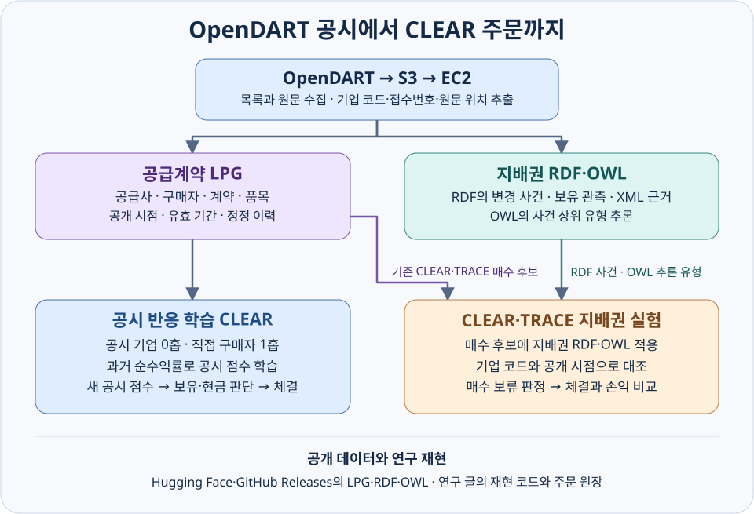
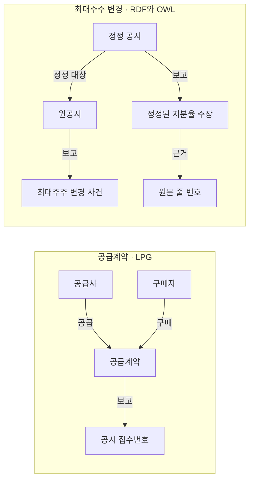

# FINTOS OpenDART Knowledge Graph



FINTOS는 금융감독원 OpenDART 공시에서 **기업·공급계약·지배권 변경과 원문 근거**를 연결합니다. 어느 기업이 계약의 당사자인지, 지정한 날짜까지 어떤 조건이 공개됐는지, 정정 공시가 어떤 값을 바꿨는지를 접수번호와 원문 위치로 확인할 수 있습니다.

[전체 데이터 다운로드][download] · [데이터 설명서][data] · [CLEAR·TRACE 연구 결과][research] · [빠른 시작](#빠른-시작과-재현)

## 공개 데이터

**v1 스냅샷**은 LPG와 RDF·OWL을 제공합니다. 두 배포본은 공시 접수번호로 대조할 수 있습니다.

| 배포본 | 수록 범위 | 규모 | 형식 |
| --- | --- | --- | --- |
| **LPG** | 2026년 11월 27일 Neo4j 스냅샷. 공시 목록과 기업을 연결하고, 추출한 공급계약·시설투자·재무 관측을 포함합니다. | 공시 **253,432건**, 노드 **721,797개**, 관계 **681,886개** | 압축 CSV, Parquet |
| **RDF·OWL** | 2026년 1월 1일~11월 27일 접수분 중 원문을 확보한 공시의 메타데이터를 담았습니다. 최대주주 변경·대량보유·주식양수도·임원 및 주요주주 보고·정기보고서에서 추출한 사건, 정정, 근거도 포함합니다. | 공시 **211,458건**, 명시 트리플 **7,783,531개**, 상위 유형 추론 **41,661개** | 압축 N-Triples, OWL Turtle |

[Hugging Face에서 개별 파일 받기][hf] · [GitHub에서 전체 ZIP 받기][download] · [버전 기록][release]

공시 수는 각 배포본의 수록 기준으로 집계합니다. 공개 파일에는 DART 링크와 원문 근거 위치를 담았습니다. 원문 ZIP·XML, 내부 저장 경로 및 원문 자유서술 발췌는 배포 범위에서 제외했습니다.

## 그래프에서 확인할 수 있는 질문



- **공급계약의 당사자는 누구인가?** 공급사와 구매자가 확인된 계약에서 당사자명과 DART 접수번호를 반환합니다. [Cypher 예제](docs/dataset-release/supply-contract.cypher)
- **정정 공시로 어떤 값이 바뀌었는가?** 금호에이치티의 최대주주등 지분율은 원공시 **52.25%**에서 정정 공시 **52.39%**로 바뀌었습니다. 공개 RDF에서 두 값의 원문 근거를 각각 **111행**, **166행**으로 확인할 수 있습니다. 합병의 상위 유형인 기업구조재편도 조회할 수 있습니다. [정정 조회](docs/dataset-release/controller-correction.rq) · [상위 유형 조회](docs/dataset-release/controller-type.rq)

## 연구에서 지식그래프를 어떻게 썼나

**CLEAR**는 새 공급계약 공시를 구매자 종목의 매매에 반영하기 전에, 당시 공개돼 유효한 동일 제품군의 계약이 그 공급사와 구매자를 연결하는지 확인합니다. **TRACE**는 공개 시점에 확인할 수 있는 그래프에서 공시까지 이어지는 경로를 찾고 학습한 방향 규칙으로 신호를 만듭니다. 공개 실험은 TRACE의 경로 탐색을 OpenDART 구조화 공시에 적용했으며, CLEAR와 TRACE에 같은 주문 규칙을 사용했습니다.

2026년 10월 1일~11월 26일의 **39거래일** 동안 두 전략에 공시 후보가 있었던 **7종목**의 비용 후 순수익률을 비교했습니다. 종목별 초기 자본은 동일하게 배정했고 왕복 비용 20bp를 적용했습니다.

| 전략 | 7종목 합산 순수익률 |
| --- | ---: |
| TRACE | −1.92% |
| CLEAR | −4.12% |
| 원문 구매자만 확인 | −15.95% |
| 20거래일 가격 추세 | −4.81% |
| 매수 후 보유 | −38.64% |

공통 후보 표본과 CLEAR의 최종 조건은 평가 구간을 검토한 뒤 정했습니다. 이 수치는 해당 기간의 탐색적 비교입니다. 주문이 바뀐 사례, 종목별 성과, 원장과 재현 코드는 연구 글에서 확인할 수 있습니다. [실험 결과와 주문 원장][research]

## 빠른 시작과 재현

1. [전체 ZIP][download]을 풀고 배포 디렉터리에서 `shasum -a 256 -c SHA256SUMS`로 파일을 확인합니다.
2. **LPG**는 Python 3.10 이상과 빈 Neo4j 5.26 이상 환경에서 아래 명령으로 적재합니다. 적재 후 Neo4j Browser에서 `supply-contract.cypher`를 실행합니다.

   ```bash
   python -m pip install neo4j
   NEO4J_URI=bolt://localhost:7687 NEO4J_USER=neo4j python import-lpg.py .
   ```

3. **RDF·OWL**은 RDF 도구에서 `rdf-asserted.nt.gz`를 N-Triples로 읽고 `controller-correction.rq`를 실행합니다. 상위 유형 질의에는 `rdf-inferred.nt.gz`도 같은 그래프에 추가합니다. [파일별 설명과 예제](docs/dataset-release/README.md)

OpenDART 수집부터 재현하려면 [로컬 실행 안내](docs/runbooks/local.md)와 [EC2 수집·백필 안내](docs/runbooks/opendart_ec2_batch.md)를 참고하세요. 초기 파일럿과 운영 전제는 [이전 README 기록](https://github.com/gugstockkg/knowledge_graph/blob/07bd5f53628020260ff61605bb7037e104af8f65/README.md)에서 확인할 수 있습니다.

## 스키마·출처·인용

| 찾는 자료 | 위치 |
| --- | --- |
| 공급계약·시설투자·재무 관측 스키마 | [경제 사건 정의서](ontology/economic-events-v0.1/) |
| 최대주주 변경의 사건·정정·근거 모델 | [최대주주 변경 정의서](ontology/controller-change-v0.1/) |
| 공개 OWL 공리와 구조 검증 예제 | [ontology.ttl][owl] · [SHACL Shape](docs/dataset-release/ownership-shapes.ttl) |
| 수집·추출·적재·연구 재현 코드 | [src/knowledge_graph](src/knowledge_graph/) · [scripts](scripts/) · [queries](queries/) |
| 파일별 SHA-256과 유형별 수록 건수 | [공개 매니페스트][manifest] |

데이터의 출처는 금융감독원 OpenDART입니다. 원문 이용 조건은 해당 자료의 권리 조건과 OpenDART 이용약관을 따릅니다. [OpenDART](https://opendart.fss.or.kr/) · [이용약관](https://opendart.fss.or.kr/intro/terms.do)

> FINTOS. (2026). *FINTOS OpenDART Knowledge Graph* (v1, 2026-11-27 스냅샷) [데이터셋]. [GitHub 릴리스][release].

개별 공시를 인용할 때는 DART 접수번호를, 연구 결과를 인용할 때는 [CLEAR·TRACE 연구 글][research]을 함께 적습니다.

[data]: https://gugstockkg.github.io/knowledge_graph/dataset/#downloads
[research]: https://gugstockkg.github.io/knowledge_graph/journal/2026-11-27-trace-backtest/
[hf]: https://huggingface.co/datasets/davidjycheong/fintos-opendart-knowledge-graph/tree/3a91f1b15e438eab120b7261bcbab5fdf30fb355
[release]: https://github.com/gugstockkg/knowledge_graph/releases/tag/fintos-opendart-20261127-v1
[download]: https://github.com/gugstockkg/knowledge_graph/releases/download/fintos-opendart-20261127-v1/fintos-opendart-20261127-v1.zip
[owl]: https://huggingface.co/datasets/davidjycheong/fintos-opendart-knowledge-graph/resolve/3a91f1b15e438eab120b7261bcbab5fdf30fb355/ontology.ttl
[manifest]: https://huggingface.co/datasets/davidjycheong/fintos-opendart-knowledge-graph/resolve/3a91f1b15e438eab120b7261bcbab5fdf30fb355/manifest.json
