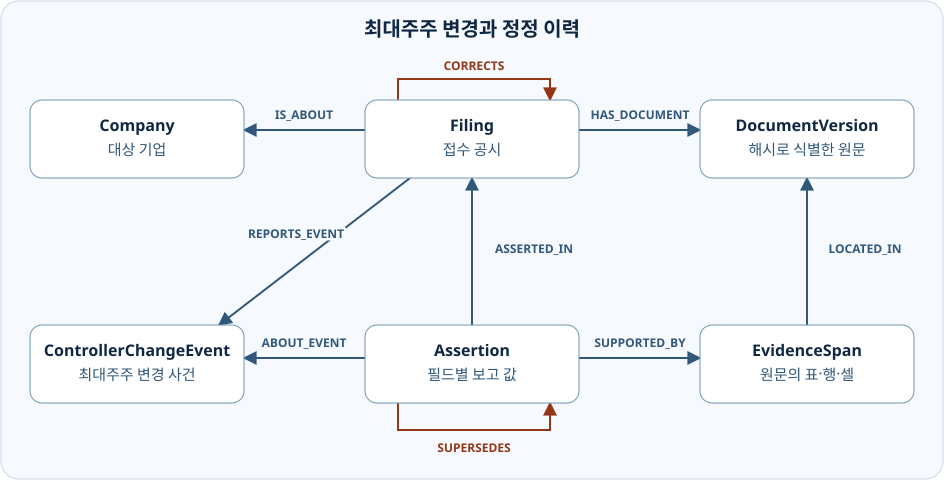

# FINTOS OpenDART 지식그래프

금융감독원 DART 공시를 출발점으로 기업, 공급계약, 지분·지배권 사건과 출처를 탐색하는 연구용 그래프다. 공시 접수번호를 통해 두 배포본에서 같은 문서를 대조할 수 있다.

| 배포본 | 경로 예시 | 범위 |
| --- | --- | --- |
| LPG | 공급사 → 공급계약 ← 구매자. 공급계약 → 접수 공시 | 노드 721,797개, 관계 681,886개. 공시 253,432건 |
| RDF·OWL | 변경 사건 ← 보고 공시 → 주장 → 원문 근거. 정정 공시 → 원공시 | 2026년 1월 1일~11월 27일에 접수된 S3 원문 211,458건. 명시 트리플 7,783,531개와 상위 유형 추론 41,661개. 본문 주장은 지분·지배권 5개 공시군에서 추출 |

두 배포본의 원본 집계 범위와 목적이 다르다. 공시 ID는 14자리 접수번호, 기업 ID는 OpenDART 기업 코드다. LPG 파일의 숫자 노드 ID는 해당 스냅샷에서 간선의 양 끝을 연결하는 키다.



공개 버전은 **2026년 11월 27일 v1**이다. 이후 EC2에 적재한 정기보고서 보유자명·역할·기초와 기말의 주식 수 및 지분율은 이 버전에 포함되지 않는다. [정기보고서 실험과 원문 근거](https://gugstockkg.github.io/knowledge_graph/journal/2026-11-28-governance-backtest/#periodic-ownership)

## v1.1 정기보고서 RDF 보강

정기보고서 12,828건의 보유 관측 83,706개에 공개용 트리플 364,537개를 추가한다. `rdf-periodic-ownership.nt.gz`를 v1의 `rdf-asserted.nt.gz`와 같은 RDF 그래프에 불러온다. 공개 범위는 기초·기말 주식 수와 지분율, 허용 목록의 역할 값, 검증 사례의 법인명 SK스퀘어다. 다른 보유자명은 배포하지 않는다. LPG와 OWL 추론 데이터는 v1을 사용한다.

`periodic-ownership.rq`는 SK스퀘어의 최대주주 역할, 기초·기말 146,100,000주, 지분율 20.07%와 20.00%, XML 50100행을 반환한다. 배포본의 `manifest.json`은 보강 파일의 건수와 SHA-256을 기록한다.

## 파일 구성

| 파일 | 내용 |
| --- | --- |
| `lpg-nodes.csv.gz` | 노드 ID, 라벨 배열과 속성 객체 |
| `lpg-relationships.csv.gz` | 관계 ID, 출발 노드 ID, 도착 노드 ID, 방향 있는 관계 타입과 속성 객체 |
| `lpg-nodes.parquet`, `lpg-relationships.parquet` | LPG CSV와 같은 행을 탐색할 수 있는 열 기반 파일. 뷰어의 train은 형식상 이름이다 |
| `rdf-asserted.nt.gz` | 명시된 RDF 사실과 근거 구조 |
| `rdf-inferred.nt.gz` | 공개 OWL 유형 계층에서 도출한 상위 유형 |
| `ontology.ttl` | OWL 클래스 선언과 하위 클래스 공리 |
| `manifest.json` | 공시 범위, 그래프 및 유형별 건수, 파일별 SHA-256 |

내부 경로, 제출인 이름, 원문 ZIP·XML, 주관식 발췌문은 배포 범위에서 제외했다. 수치·날짜, 문서 해시, 근거 줄 번호와 DART 공개 링크로 원문을 찾아 대조할 수 있다. RDF의 `receiptDate`는 공시 접수일이다. 거래일과 보고의무발생일은 원문에서 읽은 별개의 항목으로 표현한다. 배포본의 명시 트리플 수에는 공개 속성 필터가 적용된다.

정정 연결, 같은 거래, 수치 보강과 보류는 각각 다른 판정이다. 상위 유형은 제공한 클래스 계층의 결과다. 추출 정확도나 거래 신호의 유효성은 데이터 존재 여부와 별도로 검증해야 한다.

## 예제

- `supply-contract.cypher`는 구매자와 공급자가 식별된 공급계약에서 공시 접수번호와 DART 링크를 찾는다.
- `controller-correction.rq`는 금호에이치티 원공시와 정정본, 최대주주등 보고 지분율과 근거 줄 번호를 조회한다.
- `controller-type.rq`는 추론본에서 기업구조재편으로 분류된 사건을 찾는다.
- `ownership-shapes.ttl`은 공시에 연결된 근거 위치의 구조를 검사하는 검증 예제다.

RDF 도구에서 `rdf-asserted.nt.gz`를 풀어 N-Triples로 읽는다. 추론 결과도 조회하려면 별도 파일을 같은 그래프에 추가한다. Neo4j에서는 `import-lpg.py`로 비어 있는 DB에 두 LPG 파일을 적재할 수 있다.

```bash
python -m pip install neo4j  # Python 3.10 이상
NEO4J_URI=bolt://localhost:7687 NEO4J_USER=neo4j python import-lpg.py .
```

검증 예제에서 금호에이치티의 지분율은 원공시 52.25%, 정정 공시 52.39%였고, 근거 줄 번호는 각각 111과 166이다. 공개 그래프가 보존한 줄 번호는 추출 당시 XML 기준이다.

원문 출처는 [금융감독원 OpenDART](https://opendart.fss.or.kr/)다. 원문의 이용에는 [OpenDART 이용약관](https://opendart.fss.or.kr/intro/terms.do)과 해당 자료의 권리 조건이 적용된다. 인용 시에는 배포 버전과 공시 접수번호를 함께 표기한다.

[GitHub 릴리스](https://github.com/gugstockkg/knowledge_graph/releases/tag/fintos-opendart-20261127-v1) · [FINTOS 데이터 설명서](https://gugstockkg.github.io/knowledge_graph/dataset/)
