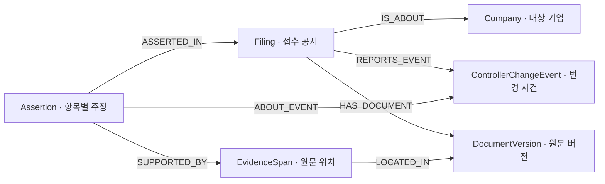

# 최대주주 변경·정정 이력 온톨로지 v0.1

이 온톨로지는 **특정 접수일에 알려진 최대주주 변경 정보와 그 원문 근거를 다시 찾기** 위해 설계했습니다. 같은 사건을 여러 공시가 설명할 때, 정정된 항목의 값만 바뀌고 나머지 항목은 기존 근거를 유지하도록 모델링합니다.

| 자료 | 내용 |
| --- | --- |
| [온톨로지 정의서 CSV](ontology.csv) | 개념, 관계, 속성, 검증 규칙의 기준 정의 |
| [범용 공시 그래프 설명서](https://gugstockkg.github.io/knowledge_graph/dataset/) | 전체 공시 목록에서 기업과 원문을 연결한 별도 스냅샷 |
| [실증 코드](../../src/knowledge_graph/graph/controller_change.py) | 검토한 원공시·정정본 한 쌍의 추출, Neo4j 적재, 기준일별 조회 |
| [발표자료 PDF](controller-change.pdf) · [PPTX](controller-change.pptx) | 연구 배경, 방법, 파일럿 결과 |

## 설계 방법과 구현 형식

**역량 질문과 공시 원문 사례를 바탕으로 설계하고, CSV로 온톨로지를 정의하며, Neo4j의 레이블 속성 그래프(LPG)로 구현합니다.**

1. **질문을 먼저 정합니다.** 기준일 현재 어느 값이 유효한지, 정정으로 무엇이 바뀌었는지, 원문 어디에서 확인할 수 있는지를 설계의 기준으로 삼습니다.
2. **공시 원문과 대조합니다.** 원공시와 정정본을 읽어 공시·사건·주장·근거를 나누고, 필드별 시간과 집계 범위를 정합니다.
3. **CSV 정의서에 기록합니다.** 개념, 관계의 출발점과 도착점, 연결 개수, 속성 자료형, 근거와 검증 규칙을 적습니다. FIBO는 금융 개념을 비교하는 참고 자료로 사용했습니다. [FIBO 검토 기록](../alignment/fibo/FIBO_review.md)
4. **Neo4j에서 구현하고 확인합니다.** 개념은 노드 라벨, 연결은 방향이 있는 관계 타입, 값은 속성으로 표현합니다. Cypher 조회로 기준일별 답을 확인하고 원문과 대조합니다. CSV 정의서의 모든 규칙이 DB 제약으로 자동 적용되는 것은 아니어서, 구조 제약과 시점 조회 테스트를 각각 관리합니다.

RDF·OWL은 현재 파일럿에서 사용하지 않았습니다. RDF는 트리플 기반 데이터 표현이고 OWL은 그 위에서 개념의 의미와 논리적 제약을 표현하는 언어입니다. RDF로 내보내 SHACL로 구조를 검사하는 방안은 후속 설계에 있습니다.

## 1. 그래프가 답할 질문

| ID | 질문 | 반환해야 하는 내용 | 현재 확인 범위 |
| --- | --- | --- | --- |
| CQ1 | 그날까지 어떤 변경 정보가 보고됐나? | 기준일에 적용되는 값, 집계 범위, 접수번호 | 한 사건의 두 접수일에서 조회 |
| CQ2 | 정정으로 무엇이 바뀌었나? | 정정을 보고한 공시, 대체된 항목과 유지된 항목, 각 근거 | 변경 후 최대주주등 지분율의 부분 정정 |
| CQ3 | 변경이 실제로 완료됐다는 근거가 있나? | 완료 근거와 출처, 또는 판정 보류 상태 | 설계 질문. 데모는 공시에 **보고된 변경일**을 반환 |
| CQ4 | 그 값은 원문 어디에 있었나? | 접수번호, 문서 버전 해시, 표·행·셀 또는 문단 위치 | 데모의 두 항목에 대해 셀 위치를 반환 |

설계 초기에 로컬 공시 목록에서 제목 정규화 후 `최대주주변경`과 정확히 일치하는 후보 230건을 찾았습니다. 이 수치는 당시 제목 검색 결과입니다. 사건 식별이나 추출 정확도는 원문과 대조한 표본에서 별도로 평가합니다.

## 2. 개념과 관계

| 개념 | 무엇을 기록하나 | 식별·해석 기준 |
| --- | --- | --- |
| `Company` | 변경이 보고된 대상 기업 | OpenDART 기업 코드를 문자열로 저장합니다. 제출인명은 대상 기업과 독립된 메타데이터입니다. |
| `Filing` | 접수된 공시 한 건 | 접수번호를 문자열로 저장합니다. 원공시와 정정본에는 각각 접수번호가 있습니다. |
| `DocumentVersion` | 해당 접수 공시에서 확보한 원문 버전 | 같은 접수번호여도 내부 원문 바이트가 달라지면 해시로 구별합니다. 데모 ID는 접수번호와 내부 XML의 SHA-256을 결합합니다. |
| `ControllerChangeEvent` | 여러 공시가 보고할 수 있는 하나의 변경 사건 | 공시 제목이 같아도 사건을 자동으로 합치지 않습니다. 데모에서는 검토한 두 공시를 고정 사건 ID로 연결합니다. |
| `Assertion` | 특정 공시가 사건의 한 항목에 대해 보고한 값 | 사건·필드·집계 범위가 같아야 값을 비교하거나 대체할 수 있습니다. 정의서에는 원문과 정규화 값이 있으며 데모는 `field`, `value`, `scope`를 사용합니다. |
| `EvidenceSpan` | 원문 속 주장 근거의 위치 | 문서 버전에 고정된 표·행·셀 또는 문단 위치입니다. 데모의 표 위치는 내부 파서가 1부터 셉니다. |



`CORRECTS`는 정정 공시에서 원공시로 이어집니다. `SUPERSEDES`는 정정한 주장부터 대체된 이전 주장으로 이어집니다. 두 관계를 함께 보존하면 문서의 이력과 개별 항목의 이력을 각각 조회할 수 있습니다.

정의서의 개념 이름은 저장소와 독립적인 논리 모델입니다. 실증 코드는 별도 라벨 `ControllerDemoCompany`, `ControllerDemoFiling`, `ControllerDemoDocument`, `ControllerDemoEvent`, `ControllerDemoAssertion`, `ControllerDemoEvidence`를 사용합니다. 데모에는 사건을 기업과 직접 잇는 `CONCERNS`도 있습니다.

## 3. 시간과 정정을 처리하는 규칙

| 기준 | 처리 방식 |
| --- | --- |
| 접수일 | 조회 기준일까지 접수된 공시의 주장만 후보로 삼습니다. 파일럿의 시간 해상도는 하루입니다. |
| 변경일과 변경확인일 | 원문에서 각각 다른 필드로 취급합니다. 변경일의 답변은 공시가 보고한 값을 인용합니다. |
| 최초 관측 시각 | 수집기가 공시를 처음 확인한 운영 기록입니다. 공개 시각은 별도 출처로 확인합니다. |
| 원공시 연결 | 원공시 접수번호가 명시돼 있으면 우선 사용합니다. 제목과 제출일만 있으면 동일 회사의 후보를 찾고 정정 항목을 대조합니다. 같은 조건의 후보가 여럿이면 연결을 보류합니다. |
| 부분 정정 | 기준일까지 접수된 정정 주장 중 같은 사건·필드·집계 범위의 값만 기존 주장을 대체합니다. 바뀌지 않은 항목은 기존 값과 근거를 사용합니다. |
| 집계 범위 | 최대주주 개인과 ‘최대주주등’ 그룹을 구분합니다. 정정 전후에도 동일 범위끼리 비교합니다. |
| 당일 충돌·완료 판정 | 같은 날의 공시 순서를 입증할 수 없고 답이 달라지면 보류하도록 설계했습니다. 완료는 이를 뒷받침하는 별도 공시 근거가 있을 때 판정합니다. |

## 4. EC2 파일럿에서 확인한 결과

금호에이치티의 공시 두 건을 S3 원문에서 읽어 Neo4j에 적재했습니다. 한 사건에 대해 주장 세 개를 적재했고, 그래프에는 **노드 12개와 관계 21개**가 생성됐습니다.

| 조회 기준일 | 변경 후 최대주주등 지분율 | 지분율 근거 | 공시가 보고한 변경일 | 변경일 근거 |
| --- | ---: | --- | --- | --- |
| 2026-10-28 | 52.25% | [20261028800611](https://dart.fss.or.kr/dsaf001/main.do?rcpNo=20261028800611) · 표 1 / 행 6 / 셀 2 | 2026-10-27 | 원공시 · 표 1 / 행 11 / 셀 2 |
| 2026-10-29 | 52.39% | [20261029800490](https://dart.fss.or.kr/dsaf001/main.do?rcpNo=20261029800490) · 표 4 / 행 6 / 셀 2 | 2026-10-27 | 원공시 · 표 1 / 행 11 / 셀 2 |

10월 29일 조회에서 지분율 주장의 접수번호와 근거 위치가 함께 바뀌었습니다. 변경일은 여전히 원공시의 셀에 연결됐습니다. 같은 원문 쌍을 다시 적재했을 때도 동일한 결과를 확인했습니다.

## 5. 재현과 조회

저장소 루트에서 아래 명령을 실행합니다. `ORIGINAL.zip`과 `CORRECTION.zip`에는 위 표에 해당하는 원공시와 정정본의 로컬 경로를 순서대로 넣습니다. 추출만 실행하면 원문 근거가 포함된 JSON이 출력됩니다. `--load`는 설정된 Neo4j에 적재하고 두 기준일의 결과를 검증합니다. DB 인증 값은 서버 환경설정으로 주입합니다.

```bash
PYTHONPATH=src python3 -m knowledge_graph.graph.controller_change ORIGINAL.zip CORRECTION.zip
PYTHONPATH=src python3 -m knowledge_graph.graph.controller_change ORIGINAL.zip CORRECTION.zip --load
```

Neo4j Browser에서 아래 조회의 날짜를 10월 28일과 29일로 바꿔 각각 실행하면, 그날 적용할 값과 원문 위치를 비교할 수 있습니다.

```cypher
WITH date('2026-10-28') AS cutoff
MATCH (a:ControllerDemoAssertion)-[:ABOUT_EVENT]->
      (:ControllerDemoEvent {id: 'demo:20261028800611'}),
      (a)-[:ASSERTED_IN]->(f:ControllerDemoFiling),
      (a)-[:SUPPORTED_BY]->(s:ControllerDemoEvidence)
         -[:LOCATED_IN]->(v:ControllerDemoDocument)
WHERE f.receipt_date <= cutoff
  AND NOT EXISTS {
    MATCH (a)<-[:SUPERSEDES]-(:ControllerDemoAssertion)
          -[:ASSERTED_IN]->(r:ControllerDemoFiling)
    WHERE r.receipt_date <= cutoff
  }
RETURN a.field AS field, a.value AS value, a.scope AS scope,
       f.receipt AS receipt, s.locator AS locator, v.sha256 AS sha256
ORDER BY field;
```

## 6. 검증 기준과 다음 실증 범위

| 검사 | 어떤 질문을 검증하나 | 상태 |
| --- | --- | --- |
| 필드 추출 | 변경 후 그룹 지분율과 변경일 셀이 하나씩 식별되는가? 중복 후보를 발견하면 중단하는가? | 코드와 단위 테스트 |
| 시간 조회 | 다음 날 접수된 정정이 앞날 답변에 들어가거나, 다른 필드까지 대체되는가? | EC2에서 원공시·정정본 한 쌍으로 확인 |
| 원문 대조 | 접수번호와 해시로 원문을 찾고 지정한 셀에서 값을 재현할 수 있는가? | 파일럿에서 지분율·변경일의 근거 확인 |
| 구조 제약 | RDF로 내보냈을 때 주장에 근거가 있고 근거가 문서 버전을 가리키는가? | SHACL 적용 설계. 파일럿 결과에는 포함되지 않음 |
| 경계 사례 | 다중 정정, 같은 날 충돌, 철회, 개인·그룹 혼재, 완료 근거 누락을 처리하는가? | 추후 독립 원문 쌍으로 검증 |

SHACL은 필수 링크와 자료형을 검사하는 데 씁니다. 정정의 적용 시점과 실제 셀의 값은 각각 조회 테스트와 원문 대조로 검증합니다. 표본을 확대할 때는 원공시 연결률, 항목 추출의 정밀도·재현율, 원문 위치 일치율을 따로 산출합니다.

[OpenDART 공시검색 개발가이드](https://opendart.fss.or.kr/guide/detail.do?apiGrpCd=DS001&apiId=2019001) · [기본 온톨로지 v0.1](../v0.1/README.md) · [W3C SHACL](https://www.w3.org/TR/shacl/) · [SHACL GraphRAG 사례](https://github.com/shinysong/shacl-graphrag)
