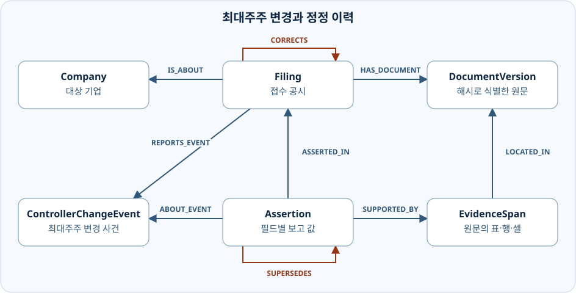

# 최대주주 변경·정정 이력 온톨로지 v0.1

이 온톨로지는 **특정 접수일에 알려진 최대주주 변경 정보와 그 원문 근거를 다시 찾기** 위해 설계했습니다. 같은 사건을 여러 공시가 설명할 때, 정정된 항목의 값만 바뀌고 나머지 항목은 기존 근거를 유지하도록 모델링합니다.

## 한눈에 보는 그래프



공시는 대상 기업과 변경 사건을 가리킵니다. 공시에서 읽은 지분율과 변경일은 각각 주장으로 기록하고, 주장마다 원문에서 확인할 위치를 연결합니다. 위치는 해시로 식별한 문서 버전에 고정합니다. 그림에서 갈색 화살표는 정정본에서 원공시로, 새 주장부터 이전 주장으로 향합니다.

이 도해는 Neo4j에서 검증한 핵심 모델을 보여줍니다. 대량보유 공시의 연결 판정과 RDF 유형 추론은 각각 [대량보유 공시와 사건 연결](#7-대량보유-공시와-사건-연결)과 [RDF·OWL 정의서와 Neo4j 적재](#10-rdfowl-정의서와-neo4j-적재)에 설명했습니다.

| 자료 | 내용 |
| --- | --- |
| [공개용 LPG 용어표](lpg-glossary.csv) · [공개용 RDF·OWL 및 FIBO 용어표](rdf-owl-glossary.csv) | 영문 대문자 표기, Excel용 UTF-8 BOM. 실행 식별자의 원래 표기는 아래 정의 파일 참조 |
| [온톨로지 정의서 CSV](ontology.csv) | 개념, 관계, 속성, 검증 규칙의 기준 정의 |
| [RDF·OWL 정의서 · Excel용](rdf-owl-ontology-excel.csv) · [Neo4j용 CSV](rdf-owl-ontology.csv) · [Neo4j 유형 계층 적재](import-rdf-owl-hierarchy.cypher) | EC2 비교에서 사용한 사건 유형과 RDF 속성, SHACL 제약, LPG 대응 관계 |
| [FIBO 참조 확장안 · Excel용 CSV](rdf-owl-ontology-fibo-expanded.csv) | 검증한 유형 계층 22행과 계약·보유·지배·발행 확장 제안 33행 |
| [범용 공시 그래프 설명서](https://gugstockkg.github.io/knowledge_graph/dataset/) | 전체 공시 목록에서 기업과 원문을 연결한 별도 스냅샷 |
| [실증 코드](../../src/knowledge_graph/graph/controller_change.py) | 검토한 원공시·정정본 한 쌍의 추출, Neo4j 적재, 기준일별 조회 |
| [발표자료 PDF](controller-change.pdf) · [PPTX](controller-change.pptx) | 논리 모델, 부분 정정 사례, 네 그래프 조건과 가드레일 결과 |
| [후속 EC2 검증 기록](../../docs/research/controller_four_graph_results.md) · [실행 코드](../../scripts/controller_graph_benchmark.py) | 30개사, 구조화 질의 151개, RDFLib·OWL-RL·pySHACL 및 Neo4j 비교 |

## 설계 방법과 구현 형식

**역량 질문과 공시 원문 사례를 바탕으로 설계하고, CSV로 온톨로지를 정의하며, Neo4j의 레이블 속성 그래프(LPG)로 구현합니다.**

1. **질문을 먼저 정합니다.** 기준일 현재 어느 값이 유효한지, 정정으로 무엇이 바뀌었는지, 원문 어디에서 확인할 수 있는지를 설계의 기준으로 삼습니다.
2. **공시 원문과 대조합니다.** 원공시와 정정본을 읽어 공시·사건·주장·근거를 나누고, 필드별 시간과 집계 범위를 정합니다.
3. **CSV 정의서에 기록합니다.** 개념, 관계의 출발점과 도착점, 연결 개수, 속성 자료형, 근거와 검증 규칙을 적습니다. FIBO는 금융 개념을 비교하는 참고 자료로 사용했습니다. [FIBO 검토 기록](../alignment/fibo/FIBO_review.md)
4. **Neo4j에서 구현하고 확인합니다.** 개념은 노드 라벨, 연결은 방향이 있는 관계 타입, 값은 속성으로 표현합니다. Cypher 조회로 기준일별 답을 확인하고 원문과 대조합니다. CSV 정의서의 모든 규칙이 DB 제약으로 자동 적용되는 것은 아니어서, 구조 제약과 시점 조회 테스트를 각각 관리합니다.

초기 부분 정정 파일럿은 Neo4j에서 실행했습니다. 후속 EC2 검증에서는 같은 사건 ID를 RDF IRI와 LPG의 사건 키에 대응시켰습니다. RDF는 사실과 근거를 표현하고, OWL-RL은 명시한 사건 유형 계층을 추론하며, SHACL은 RDF 데이터의 필수 근거 등 구조 제약을 검사합니다. CSV는 논리 모델의 기준 정의입니다.

## 1. 그래프가 답할 질문

| ID | 질문 | 반환해야 하는 내용 | 현재 확인 범위 |
| --- | --- | --- | --- |
| CQ1 | 그날까지 어떤 변경 정보가 보고됐나? | 기준일에 적용되는 값, 집계 범위, 접수번호 | 한 사건의 두 접수일에서 조회 |
| CQ2 | 정정으로 무엇이 바뀌었나? | 정정을 보고한 공시, 대체된 항목과 유지된 항목, 각 근거 | 변경 후 최대주주등 지분율의 부분 정정 |
| CQ3 | 변경이 실제로 완료됐다는 근거가 있나? | 완료 근거와 출처, 또는 판정 보류 상태 | 설계 질문. 데모는 공시에 **보고된 변경일**을 반환 |
| CQ4 | 그 값은 원문 어디에 있었나? | 접수번호, 문서 버전 해시, 표·행·셀 또는 문단 위치 | 데모의 두 항목에 대해 셀 위치를 반환 |

설계 초기에 로컬 공시 목록에서 제목 정규화 후 `최대주주변경`과 정확히 일치하는 후보 230건을 찾았습니다. 이 수치는 당시 제목 검색 결과입니다. 사건 식별이나 추출 정확도는 원문과 대조한 표본에서 별도로 평가합니다.

## 2. 개념과 관계

| 개념 | 무엇을 기록하나 | 식별·해석 기준 |
| --- | --- | --- |
| `Company` | 변경이 보고된 대상 기업 | OpenDART 기업 코드를 문자열로 저장합니다. 제출인명은 대상 기업과 독립된 메타데이터입니다. |
| `Filing` | 접수된 공시 한 건 | 접수번호를 문자열로 저장합니다. 원공시와 정정본에는 각각 접수번호가 있습니다. |
| `DocumentVersion` | 해당 접수 공시에서 확보한 원문 버전 | 같은 접수번호여도 내부 원문 바이트가 달라지면 해시로 구별합니다. 데모 ID는 접수번호와 내부 XML의 SHA-256을 결합합니다. |
| `ControllerChangeEvent` | 여러 공시가 보고할 수 있는 하나의 변경 사건 | 공시 제목이 같아도 사건을 자동으로 합치지 않습니다. 데모에서는 검토한 두 공시를 고정 사건 ID로 연결합니다. |
| `Assertion` | 특정 공시가 사건의 한 항목에 대해 보고한 값 | 사건·필드·집계 범위가 같아야 값을 비교하거나 대체할 수 있습니다. 정의서에는 원문과 정규화 값이 있으며 데모는 `field`, `value`, `scope`를 사용합니다. |
| `EvidenceSpan` | 원문 속 주장 근거의 위치 | 문서 버전에 고정된 표·행·셀 또는 문단 위치입니다. 데모의 표 위치는 내부 파서가 1부터 셉니다. |

`CORRECTS`는 정정 공시에서 원공시로 이어집니다. `SUPERSEDES`는 정정한 주장부터 대체된 이전 주장으로 이어집니다. 두 관계를 함께 보존하면 문서의 이력과 개별 항목의 이력을 각각 조회할 수 있습니다.

정의서의 개념 이름은 저장소와 독립적인 논리 모델입니다. 실증 코드는 별도 라벨 `ControllerDemoCompany`, `ControllerDemoFiling`, `ControllerDemoDocument`, `ControllerDemoEvent`, `ControllerDemoAssertion`, `ControllerDemoEvidence`를 사용합니다. 데모에는 사건을 기업과 직접 잇는 `CONCERNS`도 있습니다.

## 3. 시간과 정정을 처리하는 규칙

| 기준 | 처리 방식 |
| --- | --- |
| 접수일 | 조회 기준일까지 접수된 공시의 주장만 후보로 삼습니다. 파일럿의 시간 해상도는 하루입니다. |
| 변경일과 변경확인일 | 원문에서 각각 다른 필드로 취급합니다. 변경일의 답변은 공시가 보고한 값을 인용합니다. |
| 최초 관측 시각 | 수집기가 공시를 처음 확인한 운영 기록입니다. 공개 시각은 별도 출처로 확인합니다. |
| 원공시 연결 | 원공시 접수번호가 명시돼 있으면 우선 사용합니다. 제목과 제출일만 있으면 동일 회사의 후보를 찾고 정정 항목을 대조합니다. 같은 조건의 후보가 여럿이면 연결을 보류합니다. |
| 부분 정정 | 기준일까지 접수된 정정 주장 중 같은 사건·필드·집계 범위의 값만 기존 주장을 대체합니다. 바뀌지 않은 항목은 기존 값과 근거를 사용합니다. |
| 집계 범위 | 최대주주 개인과 ‘최대주주등’ 그룹을 구분합니다. 정정 전후에도 동일 범위끼리 비교합니다. |
| 당일 충돌·완료 판정 | 같은 날의 공시 순서를 입증할 수 없고 답이 달라지면 보류하도록 설계했습니다. 완료는 이를 뒷받침하는 별도 공시 근거가 있을 때 판정합니다. |

## 4. 초기 EC2 파일럿에서 확인한 결과

금호에이치티의 공시 두 건을 S3 원문에서 읽어 Neo4j에 적재했습니다. 한 사건에 대해 주장 세 개를 적재했고, 그래프에는 **노드 12개와 관계 21개**가 생성됐습니다.

| 조회 기준일 | 변경 후 최대주주등 지분율 | 지분율 근거 | 공시가 보고한 변경일 | 변경일 근거 |
| --- | ---: | --- | --- | --- |
| 2026-10-28 | 52.25% | [20261028800611](https://dart.fss.or.kr/dsaf001/main.do?rcpNo=20261028800611) · 표 1 / 행 6 / 셀 2 | 2026-10-27 | 원공시 · 표 1 / 행 11 / 셀 2 |
| 2026-10-29 | 52.39% | [20261029800490](https://dart.fss.or.kr/dsaf001/main.do?rcpNo=20261029800490) · 표 4 / 행 6 / 셀 2 | 2026-10-27 | 원공시 · 표 1 / 행 11 / 셀 2 |

10월 29일 조회에서 지분율 주장의 접수번호와 근거 위치가 함께 바뀌었습니다. 변경일은 여전히 원공시의 셀에 연결됐습니다. 같은 원문 쌍을 다시 적재했을 때도 동일한 결과를 확인했습니다.

## 5. 재현과 조회

저장소 루트에서 아래 명령을 실행합니다. `ORIGINAL.zip`과 `CORRECTION.zip`에는 위 표에 해당하는 원공시와 정정본의 로컬 경로를 순서대로 넣습니다. 추출만 실행하면 원문 근거가 포함된 JSON이 출력됩니다. `--load`는 설정된 Neo4j에 적재하고 두 기준일의 결과를 검증합니다. DB 인증 값은 서버 환경설정으로 주입합니다.

```bash
PYTHONPATH=src python3 -m knowledge_graph.graph.controller_change ORIGINAL.zip CORRECTION.zip
PYTHONPATH=src python3 -m knowledge_graph.graph.controller_change ORIGINAL.zip CORRECTION.zip --load
```

Neo4j Browser에서 아래 조회의 날짜를 10월 28일과 29일로 바꿔 각각 실행하면, 그날 적용할 값과 원문 위치를 비교할 수 있습니다.

```cypher
WITH date('2026-10-28') AS cutoff
MATCH (a:ControllerDemoAssertion)-[:ABOUT_EVENT]->
      (:ControllerDemoEvent {id: 'demo:20261028800611'}),
      (a)-[:ASSERTED_IN]->(f:ControllerDemoFiling),
      (a)-[:SUPPORTED_BY]->(s:ControllerDemoEvidence)
         -[:LOCATED_IN]->(v:ControllerDemoDocument)
WHERE f.receipt_date <= cutoff
  AND NOT EXISTS {
    MATCH (a)<-[:SUPERSEDES]-(:ControllerDemoAssertion)
          -[:ASSERTED_IN]->(r:ControllerDemoFiling)
    WHERE r.receipt_date <= cutoff
  }
RETURN a.field AS field, a.value AS value, a.scope AS scope,
       f.receipt AS receipt, s.locator AS locator, v.sha256 AS sha256
ORDER BY field;
```

## 6. 검증 기준과 다음 실증 범위

| 검사 | 어떤 질문을 검증하나 | 상태 |
| --- | --- | --- |
| 필드 추출 | 변경 후 그룹 지분율과 변경일 셀이 하나씩 식별되는가? 중복 후보를 발견하면 중단하는가? | 코드와 단위 테스트 |
| 시간 조회 | 다음 날 접수된 정정이 앞날 답변에 들어가거나, 다른 필드까지 대체되는가? | EC2에서 원공시·정정본 한 쌍으로 확인 |
| 원문 대조 | 접수번호와 해시로 원문을 찾고 지정한 셀에서 값을 재현할 수 있는가? | 파일럿에서 지분율·변경일의 근거 확인 |
| 구조 제약 | RDF로 내보냈을 때 주장에 근거가 있고 근거가 문서 버전을 가리키는가? | 후속 EC2 검증에서 RDF의 출처를 제거하면 실패하고 복원하면 통과함 |
| 경계 사례 | 다중 정정, 같은 날 충돌, 철회, 개인·그룹 혼재, 완료 근거 누락을 처리하는가? | 추후 독립 원문 쌍으로 검증 |

SHACL은 필수 링크와 자료형을 검사하는 데 씁니다. 정정의 적용 시점과 실제 셀의 값은 각각 조회 테스트와 원문 대조로 검증합니다. 표본을 확대할 때는 원공시 연결률, 항목 추출의 정밀도·재현율, 원문 위치 일치율을 따로 산출합니다.

[OpenDART 공시검색 개발가이드](https://opendart.fss.or.kr/guide/detail.do?apiGrpCd=DS001&apiId=2019001) · [기본 온톨로지 v0.1](../v0.1/README.md) · [W3C SHACL](https://www.w3.org/TR/shacl/) · [SHACL GraphRAG 사례](https://github.com/shinysong/shacl-graphrag)

## 7. 대량보유 공시와 사건 연결

CQ5는 “이 최대주주 변경 공시와 같은 거래를 보고한 대량보유 공시는 무엇이며 어떤 원문 근거가 있는가?”를 묻습니다. 주식 이전에는 양도인·양수인·증권·이전 수량을 기록합니다. 변경 전후 최대주주와 대량보유 보고자는 각 문서가 부여한 역할입니다. 보고집단 보유 수량은 기준일별 관측으로 보존합니다.

세부행의 거래일, 계약 종결일, 최대주주 변경일, 보고의무발생일, 접수일은 각각 원문의 의미에 맞춰 기록합니다. 공시 참조는 참조 대상과 문맥을 보존합니다. 연결 판정은 같은 거래·수치 보강·별도 사건·보류로 나누며 근거가 나온 문서와 위치를 기록합니다. 사건 분류의 OWL 공리와 LPG 대응 규칙은 네 조건 비교에서 동일한 의미를 부여해야 합니다.

예를 들어 최대주주 변경 공시 [20260126900569](https://dart.fss.or.kr/dsaf001/main.do?rcpNo=20260126900569)와 두 대량보유 공시 [20260119000125](https://dart.fss.or.kr/dsaf001/main.do?rcpNo=20260119000125), [20260119000136](https://dart.fss.or.kr/dsaf001/main.do?rcpNo=20260119000136)은 원문 대조 표본에 포함됐습니다. 이 연결 검증은 위 금호에이치티의 정정 조회와 별개의 사례입니다. [검증 기록](../../docs/research/control_ownership_ec2_validation.md)

네 조건 비교에서 거래는 접수번호가 아닌 공통 사건 ID로 식별합니다. ①은 사건·공시·주장의 정정 이력과 출처를 LPG에서 조회합니다. ②는 동일 사건 ID를 RDF IRI로 매핑하고, 원인 사건의 명시적 유형과 `합병 ⊑ 기업구조재편`을 OWL 공리로 표현합니다. ③은 OWL 유형 판정과 LPG의 시점별 유효 주장을 사건 ID로 결합합니다. ④는 ③의 명시적 사실과 원문 근거를 하나의 LPG에 적재하고 같은 유형 계층을 Cypher 경로로 평가합니다. ③과 ④의 답과 근거를 대조하고 조회 시간을 비교했습니다. 결과는 다음 절에 정리했습니다.


## 8. 네 그래프 조건과 가드레일 검증

금호에이치티를 포함한 코스피 30개사의 공시에서 구조화 질의 151개를 실행했습니다. S3 원문 해시와 표 셀을 대조했으며, 질문은 긍정 91개와 반례 60개로 구성했습니다. 정답을 원문에서 대조할 수 있는 사례를 골랐으므로 독립 홀드아웃의 성능으로 해석하기는 어렵습니다.

| 질문 | ① LPG | ② OWL | ③ LPG+OWL | ④ 동일 사실·규칙의 단일 LPG |
| --- | ---: | ---: | ---: | ---: |
| 기준일 값·원문 근거 | 30/30 | 0/30 | 30/30 | 30/30 |
| 상위 유형·근거 | 0/30 | 30/30 | 30/30 | 30/30 |
| 복합 답·근거 | 0/31 | 0/31 | 31/31 | 31/31 |
| 공개 전 값 차단 | 30/30 | 30/30 | 30/30 | 30/30 |
| 유형 반례 | 0/30 | 30/30 | 30/30 | 30/30 |

③과 ④의 151개 응답은 모두 같았습니다. 복합 질의 31개를 각각 다섯 번 반복했을 때 p50·p95는 ③ **10.64·16.02ms**, ④ **4.08·5.32ms**였습니다. 단일 EC2의 조회 시간이며 OWL 사전 추론 시간은 포함하지 않았습니다. 단독 조건의 0건은 필요한 답과 근거를 모두 반환해야 통과하는 채점 기준에 따른 결과입니다.

| 검사 | EC2에서 확인한 동작 |
| --- | --- |
| SHACL 출처 제약 | 출처를 뺀 RDF에서 위반을 검출하고 복원 후 통과 |
| 시점 조회 | 공개 전 값 차단, 정정 전후의 유효 값과 근거 반환 |
| OWL 추론 | 공리 삭제 후 추론을 다시 계산하고 공리 복원 후 결과 확인 |
| 식별자와 미정의 타입 | RDF 재가져오기에서 URI 보존, 주입한 미정의 유형의 오추론 방지 |

자연어 GraphRAG의 답과 인용 정확도, 검사를 붙였을 때의 보류율은 별도 평가 항목입니다. [실험 세부 기록](../../docs/research/controller_four_graph_results.md) · [GraphRAG 평가 계획](https://gugstockkg.github.io/knowledge_graph/journal/2026-11-27-graphrag-evaluation/)

## 9. 데이터와 사건 연결의 범위

- 확인한 S3 원문 경로에는 2026년 접수번호 기준 **207,632건**이 있었습니다. 지분·지배권 후보 **44,898건**을 처리해 **42,794건**에서 대상 필드를 검출했습니다. 필드 검출은 추출 정확도와 별개입니다. [S3 인벤토리와 추출 결과](../../docs/research/opendart_s3_inventory.md)
- 최대주주 변경과 대량보유 연결 규칙은 같은 입력에서 **같은 거래 126쌍**, **수치 보강 1쌍**, **별도 사건 3쌍**, **보류 441쌍**을 반환했습니다. 기존에 본 회사를 제외한 신규 연결 13쌍은 원문과 일치했습니다. 이 표본을 확인하며 규칙을 조정했습니다. [원문 대조와 연결 규칙](../../docs/research/control_ownership_ec2_validation.md)
- 주식양수도, 임원·주요주주 보고, 정기보고서는 필드 추출까지 진행했습니다. 추가 공시군의 사건 연결과 그래프 적재를 검증하는 작업이 남아 있습니다.


## 10. RDF·OWL 정의서와 Neo4j 적재

[RDF·OWL 정의서 CSV](rdf-owl-ontology.csv)는 네 조건 실험에서 [비교 코드](../../scripts/controller_graph_benchmark.py)가 생성한 유형과 공리를 사람이 확인할 수 있게 정리한 것이다. `urn:fintos:benchmark:`를 실험 네임스페이스로 사용한다. `class`는 사건 유형과 SHACL 검사 대상, `subclass`는 하위 유형 공리, `property`는 실험에서 사용한 RDF 속성이다. 속성의 대상과 자료형은 실제 사용 형태를 기록한 것이며 OWL의 domain·range 공리를 추가한 것은 아니다. `shape_constraint`의 최소 개수와 자료형은 SHACL 검사에 사용하였다.

시험용 Neo4j 서버의 import 디렉터리에 CSV를 두고 [Cypher 명령](import-rdf-owl-hierarchy.cypher)을 순서대로 실행하면 기존 실험과 같은 `BenchmarkType.id`로 유형 노드 9개와 `SUBCLASS_OF` 관계 6개를 적재한다. 마지막 조회는 하위·상위 유형 쌍을 반환한다. 사건 인스턴스의 `CLASSIFIED_AS` 연결은 비교 코드가 공시별 분류 결과에서 생성한다. SHACL 제약은 RDF에서 검사하며, 이 Cypher 명령이 Neo4j 제약으로 설치하지는 않는다.


FIBO 검토를 반영한 확장 CSV에는 원문 근거와 Neo4j 대응 이름을 함께 기록하였다. ‘EC2 비교 검증’은 기존 실험 항목이며, ‘설계 제안’은 확장 후보이다. 참조 IRI와 매핑 판정은 설계 검토용 주석이다. 새 OWL 동치 공리나 운영 그래프 변경을 선언하는 자료는 아니다. [FIBO 검토 근거](../alignment/fibo/FIBO_review.md)

### 정기보고서 보유 관측의 RDF 속성

정기보고서에서 파싱한 보유자 행은 기존 `reportsAssertion`의 목적어이며, `aboutEvent`로 기간별 보유 현황을, `supportedBy`로 XML 행을 가리킨다. 여기에 `reportedHolderName`과 `reportedHolderRole`, 정수형 `openingShareCount`와 `closingShareCount`, 소수형 `openingOwnershipPercent`와 `closingOwnershipPercent`를 추가하였다. 지분율 단위는 퍼센트다. 보유자명이 합계인 행과 숫자 자릿값을 확인할 수 없는 행은 이 속성의 적재 대상에서 제외한다. 원문에 대시로 표시한 값은 생략한다.

최대주주 교체는 기업별로 앞서 공개된 직전 분기와 현재 보고서의 최대주주 이름을 비교한 결과다. 최초 공시의 일자와 마찬가지로 보고서 접수일 다음 거래일부터 사용할 수 있다. 교체 판정은 두 관측의 비교이며, 별도 최대주주 변경 공시의 사건 유형과 원문 근거는 그대로 보존한다.
